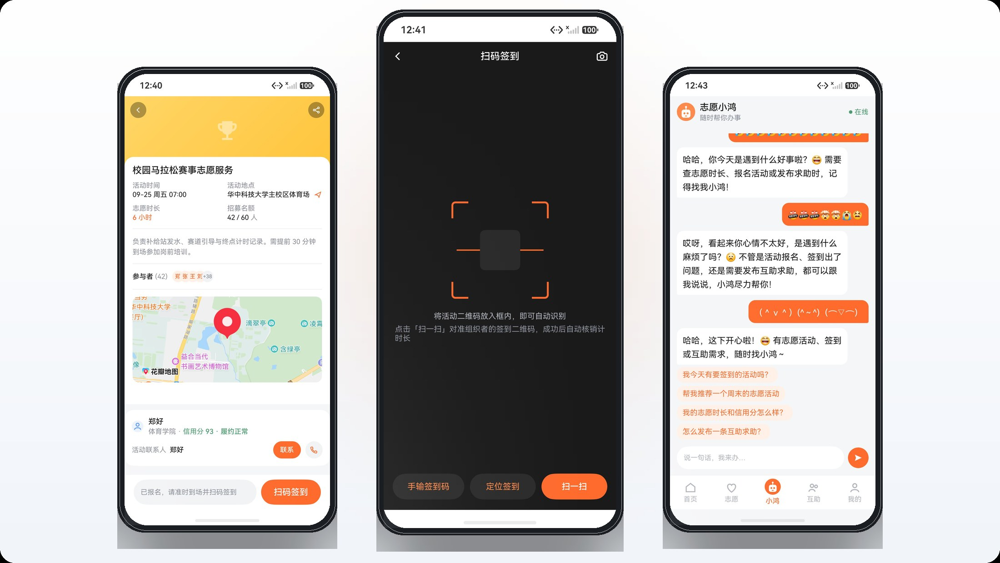
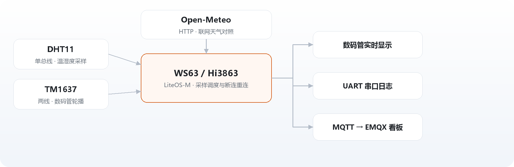

<picture>
  <source media="(prefers-color-scheme: dark)" srcset="assets/banner-dark.svg">
  
</picture>

HarmonyOS 应用 + WS63 固件，端上一套、板子上一套。近期在把鸿志愿的长列表复用、图片解码时机和首屏时序重做一遍。

---

### HeartVol

<picture>
  <source media="(prefers-color-scheme: dark)" srcset="assets/showcase-apps-dark.jpg">
  
</picture>

校园志愿服务与互助平台。志愿者端 18 个页面，服务端 31 个 REST 接口、12 张表 —— 从活动发布、扫码签到、时长认定，到证书生成和互助接单，整条链路跑通，桌面卡片与跨端分享也一并做了。

ArkTS · ArkUI · Stage 模型 · Spring Boot 3 · MySQL 8 · HMAC-SHA256 令牌 · Map Kit · Scan Kit · Form Kit

### fbb_ws63-application

<picture>
  <source media="(prefers-color-scheme: dark)" srcset="assets/showcase-ws-dark.png">
  
</picture>

海思 Hi3863 SDK 的应用层，主体是一台自己搭的桌面气象站：DHT11 走单总线取温湿度，TM1637 轮播显示，联网拉 Open-Meteo 与本地读数做对照，MQTT 周期上报并接受反向下发；RGB 状态灯、数码管和串口三层输出并行不阻塞。

C · LiteOS-M · GPIO / UART / I2C · MQTT · EMQX · Open-Meteo

### HongYuanShe

校园社区客户端，纯端侧。ArkTS 写界面，数据全落在 RelationalStore 的四张表里，Preferences 只存一个 userId。列表走 LazyForEach + IDataSource，点赞去重交给 UNIQUE 索引，不在代码里判断。

ArkTS · ArkUI · RelationalStore · Preferences · Navigation

### April-arkts

ArkTS 起步时一页页敲下来的练手工程：语法、声明式 UI、页面路由、列表渲染、表单与弹窗。

### 取舍

- 鉴权不引 Spring Security —— 移动端只需要一条 Bearer 链路，拦截器加 HMAC-SHA256 令牌就够，少一层框架少一处线上不可控。
- 服务端用 JdbcTemplate 手写 SQL —— 慢查询和索引问题看得见，不用猜框架生成了什么。
- 硬件参数只留一个入口 —— 引脚、采样周期、Broker 各一处收在 `app_config.h`，换一块板子不动驱动源码。
- 能重新生成的都不进仓库 —— 构建产物、签名材料、固件二进制一律忽略。

---

<a href="https://github.com/q2401023554">GitHub</a> · <a href="https://heartgun.cn">heartgun.cn</a> · <a href="https://space.bilibili.com/258946775">Bilibili</a>

